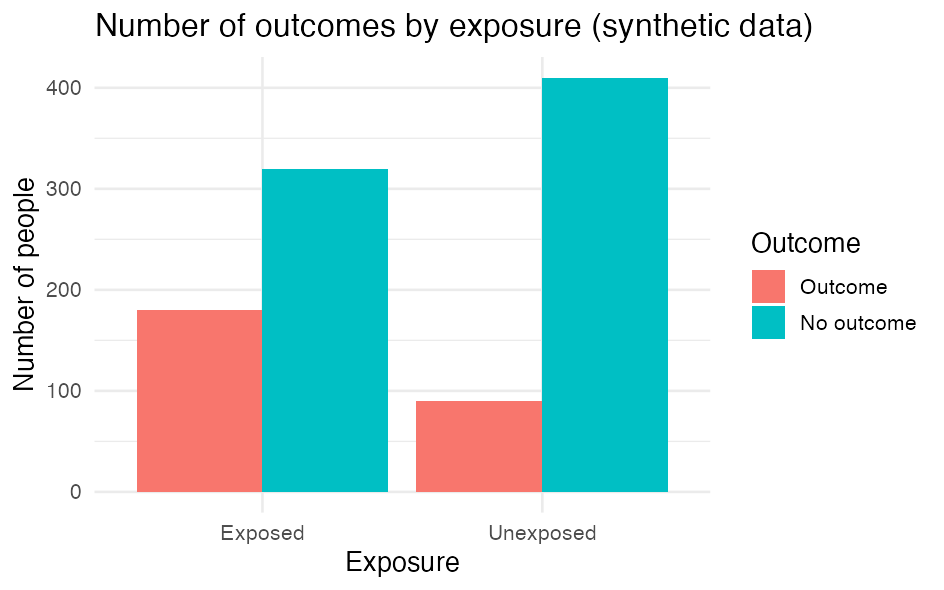
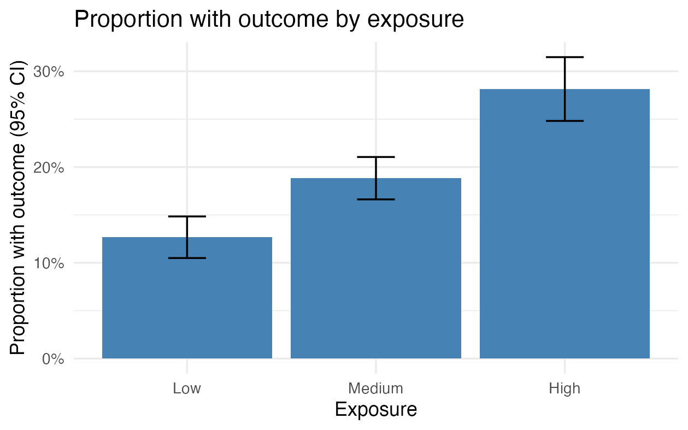
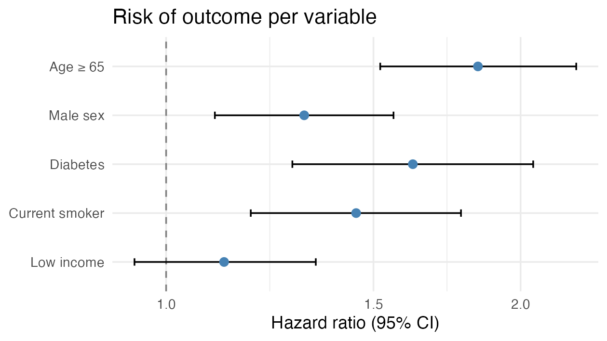

Use this page when your analysis is done and you want figures for the paper:
bar charts of counts, proportions with confidence intervals, and forest plots of
model estimates, built with [`ggplot2`](https://ggplot2.tidyverse.org/) and
saved to a file. You start from the analysis-ready dataset ([Phase
12](data-manipulation.qmd)) or a fitted model ([Regression](regression.qmd),
[Time-to-event](time-to-event.qmd)). On DST a figure is judged as if it were the
table behind it, so you aggregate first and plot the aggregated numbers: a
scatterplot with one point per person cannot leave. The rules are on [Export
and repatriation](export.qmd#figures-and-curves).

*Paths and variable names in the examples are generic - replace them with your own.*
`ggplot2` must be installed in your R environment on DST.

## Bar chart of counts {#example}

Build the figure from your dataset. Here we count the number of people per group
and draw a bar chart.

```r
library(ggplot2)                       # ggplot(), geom_*, ggsave()
library(dplyr)                         # %>% and count()

df <- readRDS("path/to/analysis.rds")  # analysis-ready dataset

# Aggregate FIRST - the figure must show numbers, not individuals
counts <- df %>%
  count(exposure, outcome = factor(outcome)) # number of people per combination; factor() so 0/1 become two colours

p <- ggplot(counts, aes(x = exposure, y = n, fill = outcome)) +  # map columns to axes/colour
  geom_col(position = "dodge") +       # bars from the counted numbers, side by side per group
  labs(                                # all text on the figure:
    title = "Number of outcomes by exposure",                 # title
    x = "Exposure", y = "Number of people", fill = "Outcome"  # x-axis, y-axis, legend
  ) +
  theme_minimal()                      # clean, light look

p                                      # print the figure (show it in the Plots pane)
```

With simulated numbers the figure looks like this:



The key parts:

- `aes()` maps columns to the figure's axes (`x`, `y`) and e.g. `fill` (colour).
- `geom_col()` draws bars from values you have counted yourself (unlike
  `geom_bar()`, which counts rows for you).
- `labs()` sets the title and axis/legend text; `theme_minimal()` gives a clean
  look.

## Customise the look

A figure is built up layer by layer with `+`: you start with `ggplot(...)`
and add a new line for each thing you want to change. What a function should
control, you write inside its parentheses as an argument, e.g.
`labs(title = "...")`.

Because we saved the figure in the object `p` in the code block above, you can
build on it with `+`: you write only what you want to add or change, not
the whole code again. (This requires that you have run the first code block, so
`p` exists in your session.)

```r
p +                                                       # the figure from before
  labs(                                                   # new text (overrides what p already has):
    title = "Number of people per group",                 #   new title
    x = "Group", y = "Count", fill = "Outcome") +         #   x-axis, y-axis, legend
  scale_fill_manual(values = c("#4C72B0", "#DD8452")) +   # pick the bar colours yourself
  theme_minimal(base_size = 14) +                         # clean theme, slightly larger text
  theme(legend.position = "bottom")                       # move the legend to the bottom
```

Each line is one layer. The order mostly does not matter, with one exception:
a complete theme such as `theme_minimal()` resets every theme setting, so put
your own `theme(...)` after it, or the legend goes back to the right. A few
typical moves:

- **Colour by a variable** goes inside `aes()` (e.g. `fill = outcome` as in the
  example at the top of the page - made a factor there, since a numeric 0/1
  would get a continuous colour scale); you then control the colours with
  `scale_fill_manual(values = ...)` or a ready-made palette
  (`scale_fill_brewer()`). If you instead want **one fixed colour** for all
  bars, write `fill = "steelblue"` inside `geom_col()`, i.e. *outside* `aes()`.
- **Axes:** `scale_y_continuous(...)` controls breaks; `coord_cartesian(ylim =
  c(0, 100))` zooms to a min/max without dropping data (`lims()` removes values
  outside the limits).
- **Layout:** `coord_flip()` makes the bars horizontal (good for many
  categories); `facet_wrap(~ variable)` makes one panel per group.

Each function has many more arguments - look them up with e.g. `?labs` or
`?scale_fill_manual`.

## Figure with error bars (proportion and 95% CI)

The bar chart above shows raw counts. In register work you will often rather
show a proportion or rate with a confidence interval, so the figure also
shows the uncertainty. Error bars (`geom_errorbar()`) draw the interval on top
of each bar or point.

Aggregate first again: one row per group with count, proportion and interval.
Here we assume `outcome` is coded 0/1.

```r
library(ggplot2)                       # ggplot(), geom_col(), geom_errorbar()
library(dplyr)                         # %>%, group_by(), summarise()

df <- readRDS("path/to/analysis.rds")  # analysis-ready dataset; outcome is 0/1

# Aggregate to one row per group: count, proportion with outcome and a 95% CI
props <- df %>%
  group_by(exposure) %>%                           # one group per exposure level
  summarise(
    n    = n(),                                    # number of people in the group
    x    = sum(outcome),                           # number with outcome (outcome coded 0/1)
    prop = x / n,                                  # proportion with outcome
    se   = sqrt(prop * (1 - prop) / n),            # standard error of the proportion
    .groups = "drop"
  ) %>%
  mutate(
    lower = prop - 1.96 * se,                      # lower bound of the 95% CI
    upper = prop + 1.96 * se                       # upper bound of the 95% CI
  )

p2 <- ggplot(props, aes(x = exposure, y = prop)) +        # proportion on the y-axis
  geom_col(fill = "steelblue") +                          # bar for the proportion
  geom_errorbar(aes(ymin = lower, ymax = upper),          # error bars = 95% CI
                width = 0.2) +                            # width of the "cap" on the bar
  scale_y_continuous(labels = scales::percent) +          # show the y-axis as percentages
  labs(
    title = "Proportion with outcome by exposure",
    x = "Exposure", y = "Proportion with outcome (95% CI)"
  ) +
  theme_minimal()

p2                                     # print the figure
```

With simulated numbers the figure looks like this:



The key parts:

- `geom_errorbar()` needs `ymin` and `ymax`; we computed them as
  `prop ± 1.96 · se` and put them in the dataset beforehand.
- The interval here is a simple **Wald interval**. It works when the group is
  large and the proportion is not close to 0 or 100 %, but it becomes unreliable
  with few people or few events, and it can go below 0. Output control only
  asks for 3 or 5 people per cell, so a group small enough for this to matter
  can still pass. In that case use `prop.test(x, n)$conf.int`, a score (Wilson)
  interval, by default with continuity correction, or `binom.test(x, n)$conf.int`
  for an exact (Clopper-Pearson) one.
- **Same pattern for means:** to show a mean of a continuous variable per group
  (e.g. age at index), replace `prop` with `mean(variable)` and `se` with
  `sd(variable) / sqrt(n)`. The rest of the figure is the same.

## Forest plot (estimates with 95% CI)

A **forest plot** shows several effect estimates (hazard ratios or odds ratios)
side by side with their confidence intervals and a vertical reference line at 1
(no effect). It is a common way to show the exposure estimate across models or
subgroups. Plot the estimates you want the reader to interpret: the coefficients
of the confounders in the same model are not effects of those variables, and
showing them invites that reading (the "Table 2 fallacy", Westreich & Greenland
2013, [doi:10.1093/aje/kws412](https://doi.org/10.1093/aje/kws412)).

The code below pulls the estimates out of a fitted model with `broom::tidy()`
and plots them. To show only the exposure, filter on its term.

```r
library(broom)                         # tidy() - model results as a tidy table
library(ggplot2)                       # the figure
library(dplyr)                         # %>%

# `model` is a fitted regression model, e.g. coxph() (survival) or glm() (logistic)
est <- tidy(model, conf.int = TRUE, exponentiate = TRUE) %>%  # exponentiate: log scale -> HR/OR
  filter(term != "(Intercept)") %>%                           # drop the intercept
  mutate(term = factor(term, levels = rev(term)))             # keep the order, first on top

ggplot(est, aes(x = estimate, y = term)) +
  geom_vline(xintercept = 1, linetype = "dashed", colour = "grey50") +    # 1 = no effect
  geom_errorbar(aes(xmin = conf.low, xmax = conf.high), orientation = "y", width = 0.15) +  # 95% CI (geom_errorbarh() is deprecated since ggplot2 4.0)
  geom_point(size = 2.6, colour = "steelblue") +                          # the estimate itself
  scale_x_log10() +                                                       # HR/OR read on a log scale
  labs(x = "Hazard ratio (95% CI)", y = NULL,
       title = "Hazard ratio (95% CI)") +
  theme_minimal()
```

With simulated numbers the figure looks like this:



The key parts:

- `tidy(..., exponentiate = TRUE)` converts the coefficients from the log scale
  to **HR/OR**; `conf.int = TRUE` gives `conf.low`/`conf.high` (95% CI).
- The **reference line at 1** is "no effect": if the interval crosses 1, the
  estimate is not statistically clear (here e.g. *Low income*).
- `scale_x_log10()` puts e.g. HR 0.5 and HR 2 equally far from 1 - which is how
  ratios should be read.
- Control the **order** with `factor(term, levels = ...)`; without it ggplot
  sorts alphabetically.
- Estimates and CIs are aggregated numbers. A model fitted in a small subgroup
  can still say something about a few people, so the subgroup's size and number
  of events are cells too.

## Save the figure

`ggsave()` writes the most recent (or a named) figure to a file you can send to
output control.

```r
ggsave("figure1.png", plot = p,        # save the figure p to a file
       width = 16, height = 10, units = "cm",  # physical size
       dpi = 300)                       # resolution (300 = print quality)
```

- `width` / `height` + `units` (`"cm"`, `"mm"`, `"in"` or `"px"`) set the
  physical size; `dpi = 300` is a good resolution for print.
- Choose `.png` (raster) or `.pdf` (vector, scales crisply) depending on the
  journal's requirements.

## Check the figure before export

Aggregating is not enough on its own. A bar or a point that covers very few
individuals can still identify them, so check the group sizes behind every
element of the figure the same way you would check the cells of a table. A
single extreme value on an axis can show one person's value too. For
Kaplan-Meier and cumulative incidence curves, see [Time-to-event](time-to-event.qmd).

DST's rule that a hidden number must not be possible to work out covers figures
as well: a segment left out of a stacked bar can be read off from the bar's
total height. See [Export - a hidden number must not be possible to work
out](export.qmd#back-calculation).

::: {.callout-tip title="Further information"}
Further depth in *The Epidemiologist R Handbook*:

- [ggplot basics](https://www.epirhandbook.com/en/new_pages/ggplot_basics.html)
- [ggplot tips](https://www.epirhandbook.com/en/new_pages/ggplot_tips.html)
:::
