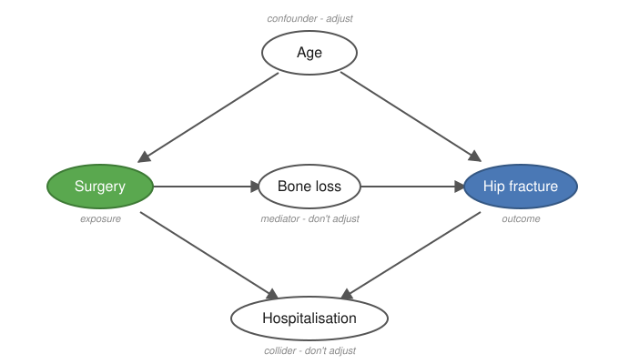

Use this page before you write any code, ideally before you apply for data. It
takes you through what to settle on paper: a precise research question, which
registers cover your exposure, outcome and covariates, which covariates to adjust
for (chosen with a causal diagram), and who your comparison group is. When you
are done you have a one-page overview of the study and the start of an analysis
plan. Nothing here needs R or access to Statistics Denmark (DST).

## What type of study are you doing? {#study-type}

Almost all register-based research is observational: you observe what has
already happened, without intervening. Registers record the past, so you cannot
randomise anyone. The two classic analytical designs are case-control and
cohort; [Phase 10](build-study-population.qmd) shows how
to build a matched cohort study.

<details>
<summary>Case-control or cohort: what is the difference?</summary>

The two designs differ in which end you start from:

| | Cohort | Case-control |
|---|---|---|
| **Starting point** | Exposure | Outcome |
| **Direction** | Follows forward: exposed → outcome | Looks back: case → prior exposure |
| **Best when** | Exposure is rare; multiple outcomes | Outcome is rare; single outcome |
| **Effect measure** | Incidence, relative risk (RR), hazard ratio | Odds ratio (OR) |
| **In registers** | Define exposed group + comparator cohort, follow forward | Find all cases, select controls, look back at exposure |

A **cohort** study follows people forward in time from the index date and measures how many develop the outcome, which is why you can compute incidence and risk. It is well suited when you have several outcomes (see the `all_dx` approach in [Extract from LPR](extract-from-lpr.qmd)).

A **case-control** study starts from those who already have the outcome and matches them with controls without it. That is efficient for rare outcomes, but cannot compute absolute risk.

With register data you can do both, because the entire population's history is available. [Phase 10](build-study-population.qmd) shows a matched cohort study step by step, and [Case-control](case-control.qmd) the other design.

</details>

## Key concepts {#key-concepts}

These five terms are used throughout the guide.

Cohort
:   A group of people followed over time because they share a particular
    characteristic at a particular point in time. Example: all patients who
    underwent bariatric surgery in the period 2010--2024.

Index date
:   The start date of follow-up, the point from which you begin counting. For
    operated patients this is typically the date of surgery. For matched
    comparators the same date as the matched operated patient is assigned.

Exposure
:   The factor whose effect you are investigating, e.g. a surgery, a
    medication, or a diagnosis.

Outcome
:   What you are measuring, e.g. onset of a disease, a hospitalisation, or
    death.

Covariates
:   Variables you include to account for confounding, that is, factors that
    affect both exposure and outcome. Examples: age, sex, comorbidity,
    socioeconomic status.

## 1. What do I want to investigate?

Formulate your research question precisely before looking at any data. The
six questions below are the ones every later page assumes you have answered.

::: {.callout-note}
**Example study (illustration only).** The examples on this page, and in many
code examples across the guide, use one made-up study: does bariatric surgery
change the risk of hip fracture? It is not a real project. The choices in it are
there to show the method, not as recommendations for your study.
:::

  | Question                                  | Example                                              |
  | ----------------------------------------- | ---------------------------------------------------- |
  | Who is my population?                     | Adults living in Denmark, 2010–2024                  |
  | What is my exposure?                      | Bariatric surgery                                    |
  | What is my outcome?                       | Hip fracture (ICD-10 S72)                            |
  | When does follow-up start?                | Date of surgery (index date)                         |
  | When does it end?                         | Diagnosis, death, emigration, or end of study period |
  | Which confounders should be adjusted for? | Age, sex, comorbidity, SES                           |

Make sure follow-up starts at the same moment eligibility and exposure are
decided. When those drift apart you get [immortal time
bias](dst-pitfalls.qmd#immortal-time-bias).

## 2. Which registers cover what?

These are the registers most cohort studies draw on, with the short names the
guide uses for them.

  | What do you need to find?          | Register                                      |
  | ---------------------------------- | --------------------------------------------- |
  | Demographics (age, sex, residence) | BEF - Population Register                     |
  | Hospital diagnoses and contacts    | LPR - National Patient Register (LPR2 + LPR3) |
  | Dispensed prescriptions            | LMDB - Prescription Register                  |
  | Date of death (for censoring)      | DOD - Death Register                          |
  | Emigration (for censoring)         | VNDS - Migration Register                     |
  | Education                          | UDDA - Education Register                     |
  | Income                             | FAIK - Family Income Register                 |
  | Employment                         | AKM - Labour Classification Module            |

Column names and join keys for each register are in [Overview of
registers](register-reference.qmd). Which register answers which question is
[Phase 8 - Find your registers](find-your-registers.qmd).

## 3. Choose your covariates using a DAG {#covariates-dag}

Adjusting for as many variables as possible is not the goal: adjusting for the
wrong ones can introduce bias instead of removing it.

A **DAG** (directed acyclic graph, a causal diagram) is a drawing of your
assumptions about how exposure, outcome and other variables relate to each
other. It makes your assumptions explicit and helps you choose the right set of
covariates.

Rules of thumb:

- **Adjust for confounders:** variables that affect both exposure and outcome
  (e.g. age, comorbidity).
- **Do NOT adjust for mediators:** variables that lie *on* the causal pathway
  between exposure and outcome (this removes part of the effect you want to
  measure).
- **Do NOT adjust for colliders:** common effects of two variables (this opens a
  spurious association).

You do not have to work the rules out by hand.
[dagitty.net](https://dagitty.net/) takes your drawing and returns the **minimal
adjustment set**: the smallest group of variables that removes the confounding
without opening a new bias through a collider.

<details>
<summary>Example study (illustration only): a DAG for surgery and hip fracture, with a confounder, a mediator and a collider</summary>

Does bariatric surgery affect the risk of hip fracture?

{#fig-dag fig-alt="Causal diagram with five variables: surgery (exposure), hip fracture (outcome), age (confounder), bone loss (mediator) and hospitalisation (collider)." width="92%"}

- **Age** is a confounder: it affects both the probability of surgery and of hip fracture. Adjust for it.
- **Bone loss** (lower bone density after surgery) is a mediator: it lies on the path surgery → bone loss → hip fracture. Do not adjust, because that removes part of the effect you want to measure.
- **Hospitalisation** is a collider: both surgery and hip fracture lead to hospitalisation. Do not adjust, because it opens a spurious association.

You can paste the model straight into [dagitty.net](https://dagitty.net/dags.html) and have the minimal adjustment set computed:

```
dag {
  Age            [pos="0,-1"]
  Surgery        [exposure, pos="-1.5,0"]
  BoneLoss       [pos="0,0"]
  HipFracture    [outcome,  pos="1.5,0"]
  Hospitalisation [pos="0,1"]
  Age      -> Surgery
  Age         -> HipFracture
  Surgery     -> BoneLoss
  BoneLoss    -> HipFracture
  Surgery     -> Hospitalisation
  HipFracture -> Hospitalisation
}
```

For this DAG the minimal adjustment set is {Age}: you only need to adjust for age.

</details>

::: {.callout-tip title="Where to learn to draw a DAG"}
- [Causal Diagrams: Draw Your Assumptions Before Your
  Conclusions](https://pll.harvard.edu/course/causal-diagrams-draw-your-assumptions-your-conclusions):
  free HarvardX course by Miguel Hernán.
- [Hernán & Robins, *Causal Inference: What
  If*](https://miguelhernan.org/whatifbook): the textbook (free PDF), also in
  [Learning resources](learning-resources.qmd).
:::

## 4. Who do you compare with? The comparison cohort {#comparator-cohort}

Many studies compare an exposed group with a **comparison cohort** (also called
a comparator cohort). How you build it is a design decision to make on paper. At
this stage you only need to settle four things:

- **Who is an appropriate comparator?** An active comparator (people with the
  same indication starting an alternative treatment, which reduces confounding
  by indication), or a matched sample of the background population.
- **What decides the comparator's index date**, since the exposure does not give
  them one.
- **Which variables you match on, and at what ratio** (e.g. age, sex and
  calendar year, 1:5).
- **What happens if a comparator becomes exposed later.**

Each of these, plus eligibility at index, the shared exclusions and the
immortal-time trap, is worked through in [Phase 10 - Build your study
population](build-study-population.qmd) and [Comparison
cohort](comparison-cohort.qmd).

## 5. Write a one-page overview of the study

Before opening R, answer these questions in writing:

1. **Which variables do I need?** (patient information - age, sex, diagnoses
   etc. - and for which years)
2. **Which registers contain this information?** (LPR, BEF, LMDB, ...)
3. **In what order should data be assembled?** (define population → extract
   outcome → extract covariates)

<details>
<summary>Example study (illustration only): overview for the hip fracture study</summary>

```
Population:   Adults who have undergone bariatric surgery, 2010–2024, identified by
              SKS procedure codes in LPR: lpr_sksopr (LPR2, to early 2019) and
              lpr_a_procregistrering (LPR3, from 2019)
              Matched comparators from the Population Register (BEF)

Outcome:      First hip fracture (LPR - ICD-10: S72)
              Date: first contact with an S72 diagnosis after the surgery date

Covariates:   Age and sex (BEF)
              Comorbidity (LPR - 5-year lookback, i.e. diagnoses in the 5 years before index date)
              Education (UDDA)
              Income (FAIK via BEF familie_id)
              Employment (AKM)

Censoring:    Death (DOD)
              Emigration (VNDS)
              End of study period (31 Dec 2024)
```

</details>

## 6. Write an analysis plan

An analysis plan is a document you write before looking at your data. It
commits you to design, statistics and variables before results can colour your
decisions.

- **Skeleton:** use the [STROBE
  checklists](https://www.strobe-statement.org/checklists/) (Strengthening the
  Reporting of Observational Studies in Epidemiology). For studies on routinely
  collected data, RECORD extends STROBE, and
  [RECORD-PE](https://www.equator-network.org/reporting-guidelines/record-pe/)
  covers pharmacoepidemiology.
- **Pre-registration:** you can register the plan publicly before you start,
  for example on the [Open Science
  Framework](https://help.osf.io/article/330-welcome-to-registrations).

::: {.callout-note}
**Power and sample size.** Even large registers have limited power (the
ability to detect an effect that is really there) for rare outcomes or small
subgroups. Already in the plan, consider the smallest effect you could
meaningfully detect with your expected number of events. The `pwr` package does
simple power and sample-size calculations; for survival and rate designs it is
the number of events, more than the number of people, that drives your power.
:::

## Next steps

Once you have your overview in place:

- **New to R:** [Phase 2 - R: the bare essentials](r-intro.qmd)
- **Ready for the DST server:** [Phase 3 - Log in to DST](log-in-dst.qmd)
