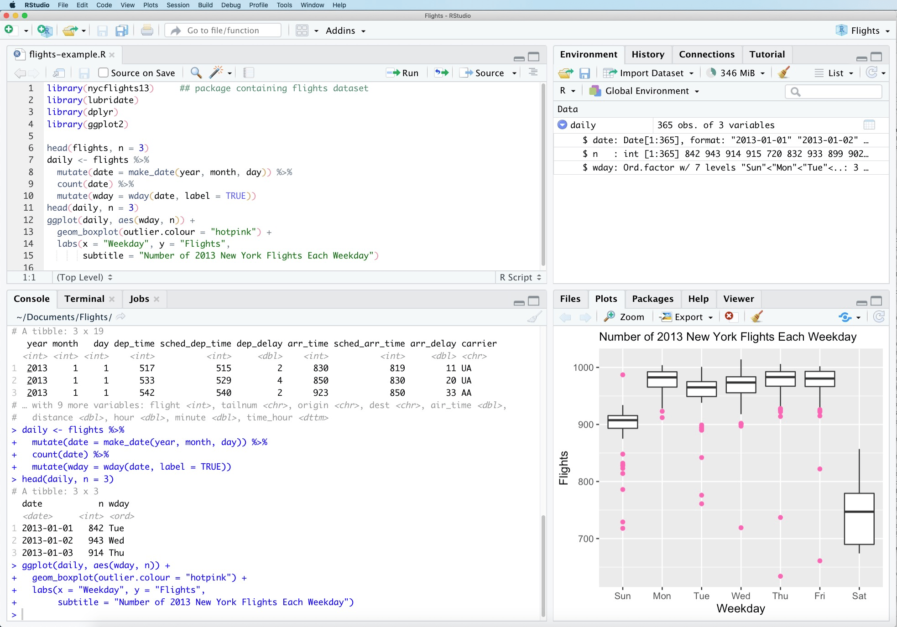

Read this page if you have never used R, before you log in to Statistics
Denmark (DST). It covers the RStudio window, running a line of code, what an
object, a function and a package are, and the six functions that appear in
almost every extraction. It is the minimum for following the code in the next
phases and does not replace an R course. Commands for looking at data come in
[Phase 7 - Inspect your data](inspect-data.qmd), once you have data to look at.

## Download R and RStudio

Both are already installed on the DST server, so you do not have to do anything
here. If you want to practise locally first, install
[R](https://cran.r-project.org/) and then [RStudio
Desktop](https://posit.co/download/rstudio-desktop/), both free. If you want to
learn R properly alongside this guide, the courses and books are in [Learning
resources](learning-resources.qmd).

## RStudio for the first time

RStudio is divided into four panels:

{fig-alt="RStudio interface with four panels"}

*Source: [Wikipedia / RStudio](https://en.wikipedia.org/wiki/RStudio), CC BY-SA
4.0*

**Top left - Script editor**

This is where you write and save your code. You can have multiple scripts open
at once and switch between them using the tabs at the top of the panel. Remember
to save changes regularly with Ctrl+S (Cmd+S on a Mac).

**Top right - Environment / History / Connections**

- **Environment:** shows all objects you have created in the current R session -
  data frames, vectors, lists. Functions from packages (e.g. `filter()` from
  dplyr) are *not* shown here; only what you have created yourself. It also
  shows how much memory each object takes, which matters on a shared server -
  see [Seeing your memory use from inside
  R](good-coding-practice.qmd#see-ram-in-r).
- **History:** a log of all commands you have run in the console.

**Bottom left - Console**

Code is executed here and output and error messages are shown here. You can type
commands directly in the console - but they are not saved. All work you want to
keep must be in a script.

**Bottom right - Files / Plots / Packages / Help**

- **Files:** a file browser for your folders and files on the server.
- **Plots:** graphs you create are shown here - even before they are saved.
- **Packages:** list of all installed packages. A tick next to a package means
  it is loaded with `library()` and ready to use.
- **Help:** help documentation, with description, arguments and examples for a
  function. Two ways in: type `?functionname` in the console (e.g. `?filter`),
  or place the cursor inside a function name in your script and press **F1**.

::: {.callout-tip}
**If a panel disappears:** go to **View → Panes → Show All Panes** in the menu
bar at the top. You can also click the icon with four squares in the menu bar.
:::

**Run code:** place the cursor on a line and press Ctrl+Enter (Cmd+Return on a
Mac). On the DST server it is Ctrl+Enter also when you connect from a Mac, see
[Phase 3](log-in-dst.qmd#mac-keyboard).

## Open a script, write one line, run it

**File → New File → R Script**

Write these three lines and run them one at a time with Ctrl+Enter:

```r
x <- 5 # assign the value 5 to the variable x
x # type the variable name to see the contents
x * 2 # use the variable in a calculation
```

### What is an object? {#what-is-an-object}

`x <- 5` *creates an object*. The arrow `<-` means "store what is on the right
under the name on the left". From now on `x` stands for the value 5 - until you
overwrite it yourself. The pattern is always the same:

```r
name <- something
```

You *name* something so you can reuse it later without writing it out again.
Almost everything in R is an object: a single number, an entire table, a model.
When you fetch (part of) a register with `collect()`, for example, you typically store it
in an object so you can keep working with it:

```r
bef_data <- bef %>% filter(year == 2020) %>% collect() # store the fetched rows in the object bef_data
```

The objects you create appear in the **Environment** panel in the top right of
RStudio.

## What is a function? A package? What does library() do?

**A function** is a command that performs an action. `filter(data, age > 50)` is
a function. `sum(c(1, 2, 3))` is a function. You recognise functions by their
parentheses.

**What is inside the parentheses?** The parentheses are always there - but they
are not always filled. It depends on whether the function needs input to know
what to do:

- `filter(age > 50)`: requires the condition; otherwise it does not know what
  to filter on
- `open_dataset("E:/workdata/...")`: requires the path; otherwise it does not
  know what to open
- `collect()`: requires nothing; it already knows what to fetch, because the
  pipe has sent data forward to it

Rule of thumb: *in a pipe*, empty parentheses usually mean the function acts on *what has been passed
forward via the pipe*, without needing anything extra from you. Outside a pipe, empty parentheses
just mean the function needs no input, e.g. `getwd()`, `Sys.Date()` or `gc()`.

**A package** is a collection of functions written by others that you can load.
R comes with base functions, but most of what this guide uses is in packages
such as `dplyr` and `arrow`.

**`library()`** loads a package so its functions are available in your session.

```r
install.packages("dplyr") # install the package once (or after a server reset)
library(dplyr) # load the package at the start of each session
```

You will see `library(dplyr)` at the top of almost every script.

## Six functions and symbols you will meet throughout the guide {#six-functions}

You will see these in almost every extraction. You do not need to understand
them in detail now, only recognise them.

The symbol `%>%` (the pipe) is everywhere. It passes the result
from one line forward as input to the next. `df %>% filter(age > 50)` means:
"take `df`, and pass it to `filter()`". This makes it possible to chain steps
together and read code from top to bottom.

  | Function      | What it does                                      | Example                                   |
  | ------------- | ------------------------------------------------- | ----------------------------------------- |
  | `filter()`    | Keep rows that meet a condition                   | `df %>% filter(age > 50)`                 |
  | `select()`    | Choose which columns to keep                      | `df %>% select(pnr, age, sex)`            |
  | `collect()`   | Fetch parquet data into R's memory                | `register %>% filter(...) %>% collect()`  |
  | `mutate()`    | Create a new column or modify an existing one     | `df %>% mutate(age_cat = age > 65)`       |
  | `left_join()` | Link two datasets - keep all rows from the left   | `cohort %>% left_join(bef, by = "pnr")`   |
  | `%>%`         | The pipe - passes the result to the next function | `df %>% filter(age > 50) %>% select(pnr)` |

The pipe `%>%` is explained in detail in [Functions:
overview](function-guide.qmd#the-pipe), and `collect()` in [Phase 5 - Extracting
data step by step](extraction-step-by-step.qmd).

## When you get stuck

Ask a colleague first, then search the error message, and treat AI as a last
resort you have to check. What to do when you see a red message, what the
common error messages mean, and how to ask a question without breaking DST's
rules are on [Troubleshooting](troubleshooting.qmd).

## Keyboard shortcuts in RStudio

The five you will use on day one. On the DST server RStudio runs on Windows, so
the Windows column is the one that applies there, also when you connect from a
Mac.

  | Mac             | Windows          | Action                                   |
  | --------------- | ---------------- | ---------------------------------------- |
  | Option + `-`    | Alt + `-`        | Insert the assignment operator `<-`      |
  | CMD + SHIFT + M | CTRL + SHIFT + M | Insert pipe (`%>%` or `\|>`)             |
  | CMD + Return    | CTRL + Enter     | Run line/selection and move to next      |
  | CMD + S         | CTRL + S         | Save                                     |
  | F1              | F1               | Open help for the function at the cursor |

<details>
<summary>More shortcuts, once you are writing longer scripts</summary>

  | Mac                  | Windows            | Action                                   |
  | -------------------- | ------------------ | ---------------------------------------- |
  | Option + Return      | Alt + Enter        | Run line/selection and stay on same line |
  | CMD + SHIFT + R      | CTRL + SHIFT + R   | Insert section heading in script         |
  | CMD + Z              | CTRL + Z           | Undo                                     |
  | CMD + SHIFT + Z      | CTRL + SHIFT + Z   | Redo                                     |
  | CMD + A              | CTRL + A           | Select all                               |
  | CMD + SHIFT + A      | CTRL + SHIFT + A   | Reformat/re-indent code                  |
  | Option + ←/→         | CTRL + ←/→         | Jump one word at a time                  |
  | Option + SHIFT + ←/→ | CTRL + SHIFT + ←/→ | Select word by word                      |

Section headings are what build the script outline - see [Find your way around a
long script](good-coding-practice.qmd#outline).

</details>

::: {.callout-tip}
**Pipe shortcut: choose which pipe is inserted.**
`Tools → Global Options → Code → Use native pipe operator` controls whether
CTRL/CMD+SHIFT+M inserts `|>` (native, newer R) or `%>%` (magrittr, the dplyr
convention).
:::

## Next steps

Next is getting onto the server: [Phase 3 - Log in to
DST](log-in-dst.qmd).
